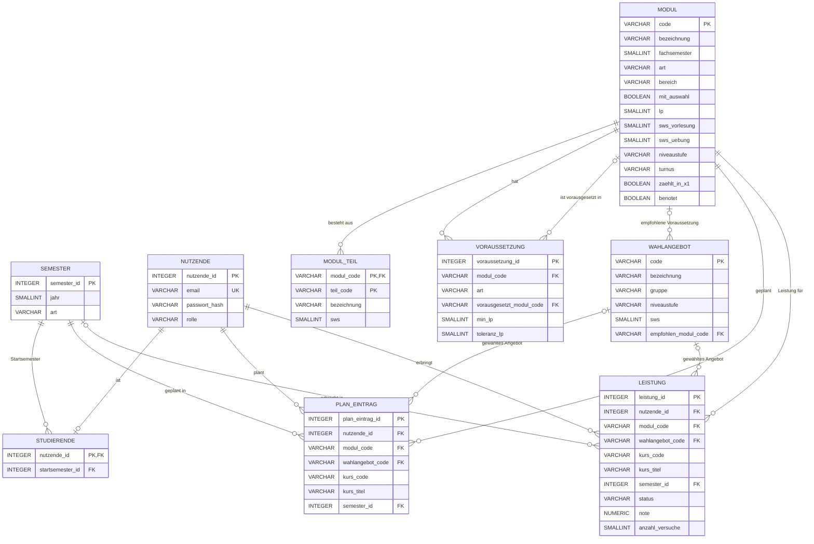
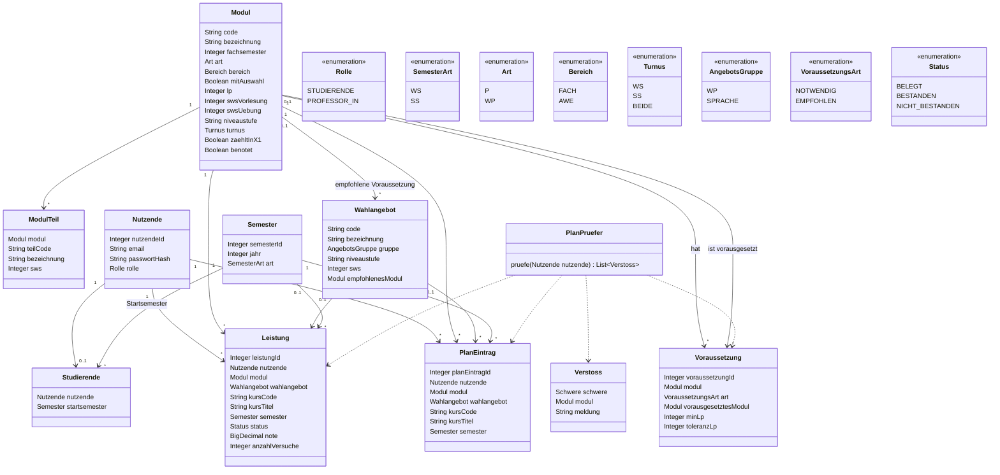

# ER-Modell und Klassenentwurf (Entwurf v2, 9 Tabellen)

**Status:** Entwurf v2. Enthält Vorschläge aus der Prüfung gegen StuPO und Rahmenordnung sowie die Antwort von Prof. Mihaljevic (13.10.2026). Die Bestätigung durch alle Personen im Team fehlt noch.

Quellen:
- StuPO Informatik und Wirtschaft vom 10. Januar 2024 (AMBl. HTW Berlin Nr. 08/24, in Kraft ab 1. Oktober 2024)
- Rahmenstudien- und -prüfungsordnung RStPO – Ba/Ma (AMBl. HTW Berlin Nr. 23/25)
- Projektfolien (Folie 29 und 30)
- Antwort von Prof. Mihaljevic zu Wahlpflichtmodulen (13.10.2026)

**Was ist neu gegenüber v1?** Kurz zusammengefasst, Details in Abschnitt 8:
- `modul`: neue Spalten `bereich`, `mit_auswahl`, `turnus`, SWS getrennt in `sws_vorlesung` und `sws_uebung`
- `wahlangebot`: neue Spalte `gruppe` (WP oder SPRACHE)
- `plan_eintrag` und `leistung`: neue Spalten `kurs_code` und `kurs_titel` für selbst eingetragene Kurse
- `art` folgt der Realität statt der StuPO (Abschnitt 5)
- E2: Ein geplantes Modul zählt nicht mehr, sobald es als `NICHT_BESTANDEN` eingetragen ist. Fehlende Noten führen zu keinem Fehler
- Zusätzliche Regel für die Bachelorarbeit (Semester 1–3) und genaue Bedeutung von `toleranz_lp`
- Nur noch erlaubte Noten (1,0 / 1,3 / … / 5,0)
- Regeln, wann ein Semester vorbei ist, wer die Semesterzeilen anlegt und wie Semester verglichen werden (nie über die ID)
- `leistung`: neue Spalte `anzahl_versuche` für Wiederholungen
- Rolle `PROFESSOR_IN` kann nicht selbst gewählt werden
- Anerkannte Leistungen und weitere Bedingungen (Abschnitt 3)
- Geltungsbereich: nur Vollzeitstudium

**Geltungsbereich:** Das Modell gilt nur für das **Vollzeitstudium**. Das empfohlene Semester eines Moduls wird aus dem Studienplan für Vollzeit (Anlage 2) berechnet. Der Teilzeitplan (Anlage 3) und die Sonderregel für Teilzeit bei der Bachelorarbeit (Semester 1–6 statt 1–3, RStPO §25 Abs. 1) sind nicht abgebildet. Die Projektfolien verlangen kein Teilzeitstudium. Studierende in Teilzeit können die App trotzdem nutzen, bekommen aber Empfehlungen für Vollzeit.

## 1. Abweichungen vom Ticket

Das Ticket nennt andere Entitäten als die 9 Tabellen dieses Modells. Die Zuordnung:

| Ticket | In diesem Modell | Begründung |
|---|---|---|
| AppUser (mit Rolle) | `nutzende` + `studierende` | Rolle steht in `nutzende`, Startsemester nur bei Studierenden in `studierende` |
| Module | `modul` | |
| ModulePrerequisite (NV/EV) | `voraussetzung` | |
| Semester | `semester` | |
| ModuleAttempt | `leistung` | eine Zeile pro Modul und Person. Die Zahl der Versuche steht in `anzahl_versuche`, einzelne Versuche werden nicht gespeichert |
| PlanEntry | `plan_eintrag` | |
| StuPO | nicht enthalten | Das Modell gilt für die StuPO 2024. Mehrere Versionen sind ein Nice-to-have (Folie 30). |
| CourseOffering, CourseGroup, Meeting | nicht enthalten | Die Folien verlangen Planung nach Modulen und Semestern und die Prüfung der Voraussetzungen (Folie 29). Zeitüberschneidungen werden nicht gefordert, und in den vorliegenden Dokumenten gibt es keine Termine oder Räume als Datenquelle. |
| (nicht im Ticket) | `modul_teil`, `wahlangebot` | `modul_teil` für B34/B35/B65, `wahlangebot` für die Auswahl bei B16/B26 und B41/B54 |

Offene Frage für das nächste Review mit den Betreuer_innen: „Soll der Stundenplan auch Zeitüberschneidungen prüfen oder nur die Voraussetzungen aus der StuPO?“ Bei der Antwort „nur Voraussetzungen“ bleibt es bei diesen 9 Tabellen.

## 2. ER-Diagramm

## 3. Beschreibung der Tabellen (Attribute, Schlüssel, Datentypen)

Datentypen für PostgreSQL. `PK` = Primärschlüssel, `FK` = Fremdschlüssel, `UK` = eindeutig.

### modul
| Spalte | Typ | Schlüssel | Hinweis |
|---|---|---|---|
| code | VARCHAR(10) | PK | z. B. B11 |
| bezeichnung | VARCHAR(150) | | |
| fachsemester | SMALLINT | | Regelsemester 1–6 |
| art | VARCHAR(2) | | `P` Pflicht, `WP` Wahlpflicht. Folgt der Realität, nicht immer der StuPO (siehe Abschnitt 5, E9) |
| bereich | VARCHAR(4) | | `FACH` oder `AWE`. AWE = B16, B26, B63, B64 (StuPO §9, Anlage 5) |
| mit_auswahl | BOOLEAN | | `true`, wenn Studierende den Inhalt wählen: B16, B26, B41, B54, B63, B64 |
| lp | SMALLINT | | Leistungspunkte |
| sws_vorlesung | SMALLINT | | SWS seminaristischer Lehrvortrag (SL). NULL, wenn keine Angabe |
| sws_uebung | SMALLINT | | SWS Übung (PCÜ, PÜ) und (Projekt-)Seminar (PS). NULL, wenn keine Angabe |
| niveaustufe | VARCHAR(2) | | `1a`, `1b` oder NULL |
| turnus | VARCHAR(5) | | `WS`, `SS` oder `BEIDE` (siehe Abschnitt 5) |
| zaehlt_in_x1 | BOOLEAN | | zählt für die Gesamtnote (StuPO §14 Abs. 3, §15) |
| benotet | BOOLEAN | | `false` nur beim Fachpraktikum (StuPO §10 Abs. 1, §11 Abs. 7) |

Beispiele für SWS: B11 „SL/PCÜ 4/2“ → `sws_vorlesung` 4, `sws_uebung` 2. B13 „SL 4“ → 4 und 0. B16 „PÜ 4“ → 0 und 4. B34 „PS“ (Teile 4 + 2) → 0 und 6. B43 und B66 → beide NULL.

### modul_teil
| Spalte | Typ | Schlüssel | Hinweis |
|---|---|---|---|
| modul_code | VARCHAR(10) | PK, FK → modul | |
| teil_code | VARCHAR(10) | PK | z. B. B34.1 |
| bezeichnung | VARCHAR(150) | | |
| sws | SMALLINT | | Alle Teile sind PÜ oder PS, deshalb reicht eine Spalte |

### voraussetzung
| Spalte | Typ | Schlüssel | Hinweis |
|---|---|---|---|
| voraussetzung_id | INTEGER | PK | |
| modul_code | VARCHAR(10) | FK → modul | das Modul, das die Voraussetzung hat |
| art | VARCHAR(10) | | `NOTWENDIG` oder `EMPFOHLEN` |
| vorausgesetzt_modul_code | VARCHAR(10) | FK → modul | vorausgesetztes Modul |
| min_lp | SMALLINT | | alternativ: geforderte Leistungspunkte |
| toleranz_lp | SMALLINT | | so viele LP dürfen unter `min_lp` noch fehlen, sonst 0 |

Bedingung: Genau eines von `vorausgesetzt_modul_code` und `min_lp` ist gesetzt.

Bedeutung von `toleranz_lp` am Beispiel Bachelorarbeit (`min_lp` 151, `toleranz_lp` 10):
- unter 141 LP → **Fehler**
- 141 bis 150 LP → **Warnung** („nur mit Zulassung durch den Prüfungsausschuss“)
- ab 151 LP → in Ordnung

### wahlangebot
| Spalte | Typ | Schlüssel | Hinweis |
|---|---|---|---|
| code | VARCHAR(10) | PK | WP1–WP15, Sprachen z. B. `EN`, `FR`, `RU`, `ES`, `DAF` |
| bezeichnung | VARCHAR(150) | | |
| gruppe | VARCHAR(10) | | `WP` (für B41/B54) oder `SPRACHE` (für B16/B26) |
| niveaustufe | VARCHAR(2) | | `1a`, `1b` oder NULL |
| sws | SMALLINT | | NULL bei Sprachen |
| empfohlen_modul_code | VARCHAR(10) | FK → modul | empfohlene Voraussetzung (EV laut Anlage 4), NULL, wenn keine |

Die 15 WP-Angebote sind laut Prof. Mihaljevic Bereiche, keine genauen Kurstitel. Jeder tatsächlich angebotene Kurs lässt sich einem Bereich zuordnen. Für AWE (B63/B64) gibt es keine Liste, weil die StuPO dort „freie Wahl“ vorsieht.

### semester
| Spalte | Typ | Schlüssel | Hinweis |
|---|---|---|---|
| semester_id | INTEGER | PK | |
| jahr | SMALLINT | | Jahr, in dem das Semester beginnt |
| art | VARCHAR(2) | | `WS` oder `SS` |

Eindeutig über (`jahr`, `art`).

**Welches Semester ist gerade?** Das berechnet der Code mit einer festen Regel, ohne Datumsspalten:
- WS `jahr` läuft vom 1. Oktober `jahr` bis 31. März `jahr + 1`
- SS `jahr` läuft vom 1. April bis 30. September `jahr`

Die genauen Vorlesungszeiten der HTW sind dafür nicht nötig. Wichtig: Ob ein Semester vorbei ist, entscheidet **nicht**, ob eine Voraussetzung erfüllt ist. Dafür zählt nur das Ergebnis (siehe E2 in Abschnitt 5).

**Wer legt die Zeilen an?** Die App legt ein Semester automatisch an, wenn es zum ersten Mal gebraucht wird (z. B. beim Planen von SS 2029). Die Tabelle muss also nicht vorab befüllt werden.

**Reihenfolge von Semestern: nie über `semester_id` vergleichen!** Die IDs werden in der Reihenfolge vergeben, in der die Semester angelegt werden, nicht in zeitlicher Reihenfolge. Plant zum Beispiel jemand zuerst SS 2029 und erst später WS 2027, hat SS 2029 die kleinere ID, liegt aber später. „Früher“ und „später“ werden deshalb immer über `jahr` und `art` bestimmt:
- erst nach `jahr` vergleichen,
- bei gleichem `jahr` kommt `SS` vor `WS` (SS 2027 beginnt im April, WS 2027 im Oktober).

Beispiel: WS 2026 < SS 2027 < WS 2027. Im Code z. B. als Sortierwert `jahr * 2 + (art = WS ? 1 : 0)`.

### nutzende
| Spalte | Typ | Schlüssel | Hinweis |
|---|---|---|---|
| nutzende_id | INTEGER | PK | |
| email | VARCHAR(200) | UK | |
| passwort_hash | VARCHAR(200) | | nie das Passwort selbst |
| rolle | VARCHAR(15) | | `STUDIERENDE` oder `PROFESSOR_IN` |

Bei der Registrierung bekommt jede Person die Rolle `STUDIERENDE`. Die Rolle `PROFESSOR_IN` kann man nicht selbst wählen, sonst könnte jede Person die Statistiken sehen. Vorschlag: Sie wird von Hand in der Datenbank gesetzt. Alternative: automatisch für bestimmte E-Mail-Adressen. Frage für das nächste Review.

### studierende
| Spalte | Typ | Schlüssel | Hinweis |
|---|---|---|---|
| nutzende_id | INTEGER | PK, FK → nutzende | |
| startsemester_id | INTEGER | FK → semester | bestimmt die Kohorte |

### plan_eintrag
| Spalte | Typ | Schlüssel | Hinweis |
|---|---|---|---|
| plan_eintrag_id | INTEGER | PK | |
| nutzende_id | INTEGER | FK → nutzende | |
| modul_code | VARCHAR(10) | FK → modul | |
| wahlangebot_code | VARCHAR(10) | FK → wahlangebot | Auswahl aus der Liste, nur bei `mit_auswahl` |
| kurs_code | VARCHAR(30) | | selbst eingetragene Veranstaltungsnummer, nur bei `mit_auswahl`. Im Plan immer optional, weil man den Kurs beim Planen oft noch nicht kennt |
| kurs_titel | VARCHAR(150) | | selbst eingetragener Kurstitel, optional |
| semester_id | INTEGER | FK → semester | geplantes Semester |

Eindeutig über (`nutzende_id`, `modul_code`).

### leistung
| Spalte | Typ | Schlüssel | Hinweis |
|---|---|---|---|
| leistung_id | INTEGER | PK | |
| nutzende_id | INTEGER | FK → nutzende | |
| modul_code | VARCHAR(10) | FK → modul | |
| wahlangebot_code | VARCHAR(10) | FK → wahlangebot | wie bei `plan_eintrag` |
| kurs_code | VARCHAR(30) | | Veranstaltungsnummer, nur bei `mit_auswahl`. Bei AWE (B63/B64) Pflicht |
| kurs_titel | VARCHAR(150) | | selbst eingetragener Kurstitel, optional |
| semester_id | INTEGER | FK → semester | kann NULL sein, z. B. bei anerkannten Leistungen |
| status | VARCHAR(15) | | `BELEGT`, `BESTANDEN`, `NICHT_BESTANDEN` |
| note | NUMERIC(2,1) | | nur 1,0 / 1,3 / 1,7 / 2,0 / 2,3 / 2,7 / 3,0 / 3,3 / 3,7 / 4,0 / 5,0 (RStPO §17 Abs. 1). Bei `BELEGT` leer, bei `BESTANDEN` höchstens 4,0, bei `benotet = false` immer leer |
| anzahl_versuche | SMALLINT | | Anzahl der Prüfungsversuche, mindestens 0, höchstens 4 |

Eindeutig über (`nutzende_id`, `modul_code`). Die erlaubten Noten prüft ein CHECK-Constraint in der Datenbank.

**Wiederholung einer Prüfung.** Es gibt weiter nur eine Zeile pro Modul und Person. Bei einer Wiederholung wird diese Zeile aktualisiert: `status`, `note` und `semester_id` bekommen die neuen Werte, und `anzahl_versuche` wird um 1 erhöht. Das passt zur RStPO §18 Abs. 1: Das Ergebnis der Wiederholung ersetzt die alte Note. Laut RStPO §18 Abs. 3 gibt es höchstens drei Versuche, einen vierten nur nach einer Studienfachberatung. Danach ist das Modul endgültig nicht bestanden. Mit `anzahl_versuche` kann die App deshalb warnen, z. B. „Achtung, das ist dein letzter Versuch“. Wann die einzelnen Versuche waren, wird nicht gespeichert.

**Anerkannte Leistungen.** Leistungen aus einem anderen Studiengang oder aus dem Mobilitätssemester (StuPO §7 Abs. 5) werden wie normale Leistungen mit `BESTANDEN` eingetragen. Ein eigener Status ist nicht nötig. Wird eine unbenotete Leistung für ein benotetes Modul anerkannt, ist die Note 4,0 (RStPO §32 Abs. 3). `semester_id` darf dabei leer bleiben, falls das Semester nicht bekannt ist.

### Weitere Bedingungen

Diese Bedingungen sichern die Daten zusätzlich ab:

| Tabelle | Bedingung | Umsetzung |
|---|---|---|
| voraussetzung | Ein Modul kann sich nicht selbst voraussetzen (`modul_code` ≠ `vorausgesetzt_modul_code`) | CHECK |
| voraussetzung | `toleranz_lp` nur zusammen mit `min_lp`, sonst 0 | CHECK |
| voraussetzung | Keine doppelten Zeilen: eindeutig über (`modul_code`, `art`, `vorausgesetzt_modul_code`, `min_lp`) | UNIQUE |
| studierende | Das Startsemester ist ein Wintersemester (StuPO §8 Abs. 1) | Service |
| plan_eintrag | Das geplante Semester liegt nicht vor dem Startsemester | Service |
| leistung | `note` nur mit erlaubten Werten, bei `BELEGT` und bei `benotet = false` leer | CHECK bzw. Service |

## 4. Beziehungen und Kardinalitäten

| Beziehung | Kardinalität | Umsetzung |
|---|---|---|
| modul – modul_teil | 1 : n | `modul_teil.modul_code` |
| modul – voraussetzung (hat) | 1 : n | `voraussetzung.modul_code` |
| modul – voraussetzung (wird vorausgesetzt) | 1 : n, optional | `voraussetzung.vorausgesetzt_modul_code` |
| modul – wahlangebot (empfohlene Voraussetzung) | 1 : n, optional | `wahlangebot.empfohlen_modul_code` |
| nutzende – studierende | 1 : 0..1 | `studierende.nutzende_id` |
| semester – studierende | 1 : n | `studierende.startsemester_id` |
| nutzende – plan_eintrag | 1 : n | `plan_eintrag.nutzende_id` |
| modul – plan_eintrag | 1 : n | `plan_eintrag.modul_code` |
| wahlangebot – plan_eintrag | 1 : n, optional | `plan_eintrag.wahlangebot_code` |
| semester – plan_eintrag | 1 : n | `plan_eintrag.semester_id` |
| nutzende – leistung | 1 : n | `leistung.nutzende_id` |
| modul – leistung | 1 : n | `leistung.modul_code` |
| wahlangebot – leistung | 1 : n, optional | `leistung.wahlangebot_code` |
| semester – leistung | 1 : n, optional | `leistung.semester_id` |

**n:m-Beziehungen und ihre Auflösung:**

| n:m | Zwischentabelle |
|---|---|
| nutzende – modul (geplant) | `plan_eintrag` |
| nutzende – modul (abgelegt) | `leistung` |
| modul – modul (Voraussetzung) | `voraussetzung` |

## 5. Modellierungsfragen

**UND/ODER bei Voraussetzungen.** Jede Zeile in `voraussetzung` ist eine eigene Bedingung, alle Bedingungen eines Moduls gelten zusammen (UND). Im Studienplan kommt kein ODER vor. Bei `EMPFOHLEN` ist eine Verletzung nur eine Warnung, bei `NOTWENDIG` ein Fehler. Falls später ein ODER nötig wird, kann eine Spalte `alternative_gruppe` ergänzt werden (gleiche Gruppe = ODER).

**Wann gilt eine Voraussetzung als erfüllt (E2)?** NV heißt laut StuPO „notwendig bestanden“ (Erläuterungen zu Anlage 2). Eine notwendige Voraussetzung ist erfüllt, wenn
- das Modul bestanden ist, **oder**
- das Modul in einem früheren Semester geplant ist **und nicht** als `NICHT_BESTANDEN` eingetragen ist.

Entscheidend ist also das Ergebnis, nicht das Datum:

| Stand beim vorausgesetzten Modul | Ergebnis der Prüfung |
|---|---|
| `BESTANDEN` | erfüllt |
| in einem früheren Semester geplant, noch kein Ergebnis (egal ob das Semester in der Zukunft liegt, gerade läuft oder schon vorbei ist) | erfüllt. Liegt das Semester schon zurück, zeigt die App den Hinweis „Ergebnis ausstehend“ |
| `NICHT_BESTANDEN` | **Fehler** |
| weder bestanden noch früher geplant | **Fehler** |

**Warum nicht „nur zukünftige oder laufende Semester zählen“?** Noten kommen oft erst Wochen nach Beginn des nächsten Semesters. Der 2. Prüfungszeitraum reicht bis in die erste Vorlesungswoche des Folgesemesters (RStPO §16 Abs. 5), und Noten müssen erst bis zu drei Wochen danach bekannt gegeben werden (RStPO §17 Abs. 7). Würden vergangene Semester nicht mehr zählen, wäre der Plan in dieser Zeit fälschlich ungültig, obwohl die Note einfach noch fehlt. Die StuPO verbietet auch nicht, das nächste Semester vor den Noten zu planen.

So bleibt Vorausplanen möglich, und eine bekannte durchgefallene Prüfung blockiert trotzdem sofort. Dieselbe Regel gilt für LP-Voraussetzungen: gezählt werden bestandene LP plus LP aus Modulen, die in früheren Semestern geplant und nicht als `NICHT_BESTANDEN` eingetragen sind.

**Anzeige in der App.** Ob eine Voraussetzung erfüllt ist, wird **nicht als Spalte gespeichert**, sondern vom `PlanPruefer` berechnet. Der Wert hängt von anderen Daten ab (neue Note, verschobenes Modul) und würde als Spalte schnell veralten. Das Backend gibt das Ergebnis im API-Response mit (z. B. `voraussetzungErfuellt` und die Liste der `Verstoss`-Objekte). Das Frontend zeigt betroffene Module dann grau mit Warnung an:
- NV nicht erfüllt → rote Fehlermeldung
- EV nicht erfüllt → gelbe Warnung

Offen fürs Team: Kann ein Modul mit nicht erfüllter NV trotzdem im Plan gespeichert werden (grau + Fehler), oder wird das Speichern blockiert?

**Bachelorarbeit und Kolloquium.**
- B66 Bachelorarbeit: `min_lp` 151, `toleranz_lp` 10 (StuPO §12, RStPO §25 Abs. 1 Satz 3).
- Zusätzlich müssen alle Module der Semester 1–3 bestanden sein (RStPO §25 Abs. 1 Satz 4). Das sind 17 weitere `NOTWENDIG`-Zeilen für B66 (B11–B16, B21–B26, B31–B35), ohne Toleranz. Am Modell ändert sich dadurch nichts.
- B65 Kolloquium: `NOTWENDIG` B66 und `min_lp` 177 (StuPO §13, RStPO §28).

**Modulart: Realität statt StuPO (E9).** In Anlage 2 sind B16, B34, B41, B43, B54, B56, B63 und B64 als WP markiert. In der Praxis wählt man bei B34, B43 und B56 aber kein anderes Modul. Bei den Projektmodulen wählt man nur Projekt oder Team, die Lehrveranstaltung ist dieselbe. Das Fachpraktikum ist laut StuPO §11 Abs. 1 sogar ein „Pflichtpraktikum“. Prof. Mihaljevic hat empfohlen, sich hier an der Realität zu orientieren (Antwort vom 13.10.2026). Deshalb gilt in diesem Modell:
- `P`: B34, B43, B56 und, nach derselben Logik, B16, B26, B63, B64 (fester Platz im Plan, gewählt wird nur der Inhalt)
- `WP`: nur B41 und B54

Die Einordnung von B16, B26, B63 und B64 ist noch bei Prof. Mihaljevic angefragt. Diese Abweichung von der StuPO ist gewollt und wird im Wiki dokumentiert.

**Auswahl bei Modulen (E10).** Bei Modulen mit `mit_auswahl = true` geben Studierende an, was sie konkret belegen:

| Module | Liste zur Auswahl | Selbst eintragen |
|---|---|---|
| B41, B54 (Wahlpflicht) | 15 Bereiche aus Anlage 4 (`gruppe = WP`) | Veranstaltungsnummer und Titel, wenn der Kurs nicht in der Liste steht |
| B16, B26 (1. Fremdsprache) | Sprachen aus Anlage 5 (`gruppe = SPRACHE`) | Veranstaltungsnummer und Titel |
| B63, B64 (AWE) | keine Liste („freie Wahl“) | Veranstaltungsnummer (**Pflicht bei der Leistung**, im Plan optional), Titel optional |

Bei AWE ist die Veranstaltungsnummer bei der Leistung Pflicht, damit eindeutig ist, welcher Kurs gemeint ist. Freier Text allein wäre zu ungenau. Im Plan bleibt sie optional, weil man beim Planen oft noch nicht weiß, welchen Kurs man belegt.

Diese Regeln prüft der Service:
- `wahlangebot_code`, `kurs_code` und `kurs_titel` nur bei `mit_auswahl = true`, sonst leer.
- Das Angebot muss zur Gruppe passen: B41/B54 nur `WP`, B16/B26 nur `SPRACHE`.
- B26 hat dieselbe Sprache wie B16.
- Ein WP-Angebot kann pro Person nur einmal gewählt werden (nicht für B41 und B54 dasselbe). Das prüft der Service und nicht die Datenbank, weil bei B16/B26 dieselbe Sprache ausdrücklich erlaubt ist.

**AWE-Bereich (E11).** `bereich = AWE` zeigt Studierenden, dass ein Modul zum allgemeinwissenschaftlichen Bereich gehört (B16, B26, B63, B64; StuPO §9, Anlage 5). Das ist unabhängig von `art`, denn ob ein Modul Pflicht ist und zu welchem Bereich es gehört, sind zwei verschiedene Fragen.

**Benotet und unbenotet.** Die Spalte `modul.benotet` sagt, ob das Modul eine Note hat. Laut StuPO §10 Abs. 1 sind alle Module benotet außer dem Fachpraktikum, das nur „mit/ohne Erfolg“ bewertet wird (§11 Abs. 7). `modul.zaehlt_in_x1` sagt getrennt davon, ob die Note in die Gesamtnote eingeht. B11–B16 sind benotet, zählen aber nicht (StuPO §14 Abs. 3, §15). Bei `benotet = false` bleibt `leistung.note` leer.

**Wintersemester, Sommersemester und Turnus (E13).** `semester.art` hält `WS` oder `SS`. Das Studium beginnt nur im Wintersemester (StuPO §8 Abs. 1). Die StuPO nennt keinen Turnus, laut RStPO §4 Abs. 2 steht er in den Modulbeschreibungen. Bis diese vorliegen, wird `modul.turnus` aus dem Fachsemester befüllt: ungerade = `WS`, gerade = `SS`. Der Teilzeitplan in Anlage 3 bestätigt diese Zuordnung. Einzelne Werte können später ohne Codeänderung angepasst werden.

**Widersprüche in der StuPO (E16).** An einigen Stellen widerspricht sich die StuPO. Dann gilt Anlage 2, weil laut §8 Abs. 2 das Studium nach dieser Anlage durchgeführt wird. Ausnahme: die Modulart (E9).
- B26: Anlage 2 sagt P, Anlage 5 sagt WP → P
- B56: Anlage 6 nennt einmal 5 LP, alle anderen Stellen 6 → 6 LP
- EV von B31 und B53 weichen im Teilzeitplan (Anlage 3) ab → Anlage 2
- B43: Anlage 2 sagt WP, §11 Abs. 1 sagt „Pflichtpraktikum“ → P (siehe E9)

## 6. Durchgespieltes Beispiel: B34 mit NV B11

**Daten:**

| Tabelle | Zeilen |
|---|---|
| modul | B11 Programmierung 1, B34 Softwareentwicklungsprojekt, B21 Programmierung 2, B24 Webtechnologien |
| voraussetzung | (B34, `NOTWENDIG`, vorausgesetzt B11), (B34, `EMPFOHLEN`, B21), (B34, `EMPFOHLEN`, B24) |
| semester | WS 2026, SS 2027, WS 2027 (die IDs sind egal, verglichen wird über `jahr` und `art`) |
| nutzende | 10, Rolle `STUDIERENDE` |
| studierende | nutzende_id 10, Startsemester WS 2026 |
| plan_eintrag | (nutzende_id 10, B11, WS 2026), (nutzende_id 10, B34, WS 2027) |

**Prüfung des Plans der Person mit nutzende_id 10:**

1. Alle `voraussetzung`-Zeilen für B34 laden. Das ergibt eine notwendige (B11) und zwei empfohlene (B21, B24).
2. Notwendig B11: Gibt es eine `leistung` der Person mit nutzende_id 10 für B11 mit `BESTANDEN`, ist die Bedingung erfüllt.
3. Sonst: Liegt der `plan_eintrag` für B11 in einem früheren Semester als WS 2027 (verglichen über `jahr` und `art`) und gibt es keine `leistung` mit `NICHT_BESTANDEN` für B11, ist der Plan ebenfalls zulässig (E2).
4. Trifft beides nicht zu, entsteht ein **Fehler**: „B34 braucht B11 (notwendig)“.
5. Empfohlen B21 und B24: Fehlen beide im Plan und unter den bestandenen Modulen, entstehen zwei **Warnungen**. Der Plan bleibt gültig.

Ergebnis:
- Plan mit B11 im WS 2026 und B34 im WS 2027, B11 noch ohne Ergebnis → gültig.
- WS 2026 ist vorbei, die Note für B11 fehlt noch → gültig, mit Hinweis „Ergebnis ausstehend“.
- B11 ist als `NICHT_BESTANDEN` eingetragen → **Fehler**, obwohl B11 im Plan steht.
- Plan mit B34 und ohne B11 → ungültig.

## 7. Klassenentwurf (Java, Spring Boot / JPA)

`Schwere` hat die Werte `FEHLER` (notwendig, oder LP unter `min_lp − toleranz_lp`) und `WARNUNG` (empfohlen, oder LP im Toleranzbereich). Der Name `PlanPruefer` ist ein Vorschlag für die Klasse, die Pläne gegen die Voraussetzungen prüft.

## 8. Entscheidungen zur Bestätigung durch das Team

| Nr. | Punkt | Vorschlag |
|---|---|---|
| E1 | Spalte `modul.benotet` | ergänzen. Bestätigt durch StuPO §10 Abs. 1: nur das Fachpraktikum ist unbenotet |
| E2 | Wann gilt eine notwendige Voraussetzung als erfüllt | bestanden **oder** in einem früheren Semester geplant und nicht `NICHT_BESTANDEN`. Es zählt das Ergebnis, nicht das Datum, weil Noten oft erst nach Semesterbeginn kommen (RStPO §16 Abs. 5, §17 Abs. 7). Gilt auch für LP-Voraussetzungen. „Erfüllt ja/nein“ wird berechnet, nicht gespeichert. Offen: Speichern bei nicht erfüllter NV erlauben oder blockieren? |
| E3 | Zeitslots und Gruppen (`CourseOffering`, `CourseGroup`, `Meeting`) | weglassen, Frage im nächsten Review stellen |
| E4 | `StuPO` als eigene Tabelle | weglassen, Modell gilt für StuPO 2024 |
| E5 | Fehlversuche (`ModuleAttempt` im Ticket) | keine eigene Tabelle, `leistung` hat eine Zeile pro Modul (RStPO §18 Abs. 1: Die Wiederholung ersetzt die alte Note). Neu: Zähler `anzahl_versuche` (0–4) für Warnungen vor dem letzten Versuch (RStPO §18 Abs. 3) |
| E6 | Sprachvarianten laut StuPO-Anlage 5 (B63 + B64 als ein 4-LP-Modul) | in v1 nicht modelliert. Eine zweite Fremdsprache oder vertiefte Sprache bei B63/B64 wird über `kurs_code` eingetragen |
| E7 | Namen in Tabellen und Klassen | Deutsch wie in der Skizze, das Ticket nennt englische Namen |
| E8 | Gendergerechte Sprache | Texte nutzen Unterstrich-Formen oder neutrale Begriffe wie in den Projektfolien (Professor_in, Studierende, Personen im Team). Technische Bezeichner sind ebenfalls neutral: Tabelle `nutzende`, Rollenwerte `STUDIERENDE` und `PROFESSOR_IN` |
| E9 | Modulart nach Realität statt StuPO | B34, B43, B56 sowie B16, B26, B63, B64 = `P`, nur B41/B54 = `WP` (Empfehlung Prof. Mihaljevic, 13.10.2026). B16/B26/B63/B64 noch bei ihr angefragt |
| E10 | Auswahl bei Modulen | neue Spalte `modul.mit_auswahl`. Liste plus eigene Eingabe für B41/B54 und B16/B26, bei AWE nur eigene Eingabe mit Pflicht-Veranstaltungsnummer. Neue Spalten `kurs_code` und `kurs_titel` in `plan_eintrag` und `leistung` |
| E11 | AWE | neue Spalte `modul.bereich` (`FACH`/`AWE`), nicht als dritter Wert in `art` |
| E12 | SWS | getrennt in `sws_vorlesung` und `sws_uebung`. PS-Stunden zählen als Übung |
| E13 | Turnus | neue Spalte `modul.turnus` (`WS`/`SS`/`BEIDE`), vorerst aus dem Fachsemester befüllt |
| E14 | Bachelorarbeit | `toleranz_lp` als Warnbereich (141–150 LP) und 17 zusätzliche NV-Zeilen für Semester 1–3 (RStPO §25). B65: NV B66 und 177 LP |
| E15 | Erlaubte Noten | nur Werte laut RStPO §17 Abs. 1, als CHECK-Constraint |
| E16 | Widersprüche in der StuPO | es gilt Anlage 2, außer bei der Modulart (E9) |
| E17 | Geltungsbereich | nur Vollzeitstudium. Teilzeitplan (Anlage 3) nicht abgebildet |
| E18 | Aktuelles Semester | feste Regel im Code (WS 1.10.–31.3., SS 1.4.–30.9.), keine Datumsspalten. Entscheidet nicht über erfüllte Voraussetzungen (siehe E2) |
| E19 | Semesterzeilen | legt die App automatisch an, wenn sie gebraucht werden |
| E20 | Rolle `PROFESSOR_IN` | nicht selbst wählbar, wird von Hand gesetzt. Frage für das nächste Review: lieber über E-Mail-Adressen? |
| E21 | Anerkannte Leistungen | als `BESTANDEN` eintragen, kein eigener Status. Unbenotet anerkannt = 4,0 (RStPO §32 Abs. 3) |
| E22 | Weitere Bedingungen | CHECK, UNIQUE und Service-Regeln laut Abschnitt 3 |
| E23 | Reihenfolge von Semestern | immer über `jahr` und `art` vergleichen, nie über `semester_id` |