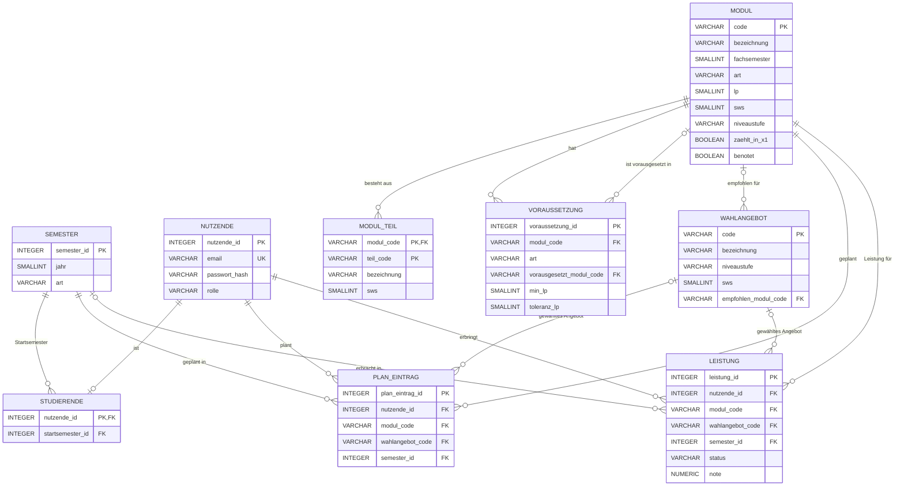
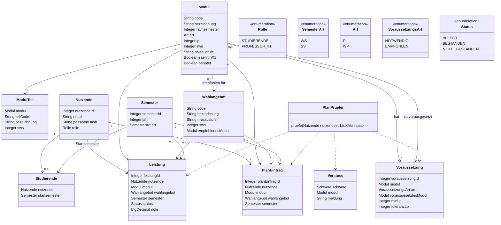

# ER-Modell und Klassenentwurf (Entwurf v1, 9 Tabellen)

**Status:** Entwurf, noch nicht „agreed v1“. Die Bestätigung durch alle Personen im Team fehlt noch.

Quellen: StuPO Informatik und Wirtschaft (AMBl. 08/24), Rahmenordnung (AMBl. 23/25), Projektfolien (Folie 29 und 30).

## 1. Abweichungen vom Ticket

Das Ticket nennt andere Entitäten als die 9 Tabellen dieses Modells. Die Zuordnung:

| Ticket | In diesem Modell | Begründung |
|---|---|---|
| AppUser (mit Rolle) | `nutzende` + `studierende` | Rolle steht in `nutzende`, Startsemester nur bei Studierenden in `studierende` |
| Module | `modul` | |
| ModulePrerequisite (NV/EV) | `voraussetzung` | |
| Semester | `semester` | |
| ModuleAttempt | `leistung` | eine Zeile pro Modul und Person (Fehlversuche werden nicht einzeln gezählt) |
| PlanEntry | `plan_eintrag` | |
| StuPO | nicht enthalten | Das Modell gilt für die StuPO 2024. Mehrere Versionen sind ein Nice-to-have (Folie 30). |
| CourseOffering, CourseGroup, Meeting | nicht enthalten | Die Folien verlangen Planung nach Modulen und Semestern und die Prüfung der Voraussetzungen (Folie 29). Zeitüberschneidungen werden nicht gefordert, und in den vorliegenden Dokumenten gibt es keine Termine oder Räume als Datenquelle. |
| (nicht im Ticket) | `modul_teil`, `wahlangebot` | stehen in der Skizze und werden für B34/B35/B65 und B41/B54 gebraucht |

Offene Frage für das nächste Review mit den Teilnehmis: „Soll der Stundenplan auch Zeitüberschneidungen prüfen oder nur die Voraussetzungen aus der StuPO?“ Bei der Antwort „nur Voraussetzungen“ bleibt es bei diesen 9 Tabellen.

## 2. ER-Diagramm

Die Spalte `benotet` in `modul` ist gegenüber der Skizze neu (siehe Abschnitt 5 und Entscheidung E1).

## 3. Beschreibung der Tabellen (Attribute, Schlüssel, Datentypen)

Datentypen für PostgreSQL. `PK` = Primärschlüssel, `FK` = Fremdschlüssel, `UK` = eindeutig.

### modul
| Spalte | Typ | Schlüssel | Hinweis |
|---|---|---|---|
| code | VARCHAR(10) | PK | z. B. B11 |
| bezeichnung | VARCHAR(150) | | |
| fachsemester | SMALLINT | | Regelsemester 1–6 |
| art | VARCHAR(2) | | `P` Pflicht, `WP` Wahlpflicht |
| lp | SMALLINT | | Leistungspunkte |
| sws | SMALLINT | | NULL, wenn nicht angegeben |
| niveaustufe | VARCHAR(2) | | `1a`, `1b` oder NULL |
| zaehlt_in_x1 | BOOLEAN | | zählt für die Gesamtnote |
| benotet | BOOLEAN | | `false` z. B. beim Fachpraktikum (Vorschlag E1) |

### modul_teil
| Spalte | Typ | Schlüssel | Hinweis |
|---|---|---|---|
| modul_code | VARCHAR(10) | PK, FK → modul | |
| teil_code | VARCHAR(10) | PK | z. B. B34.1 |
| bezeichnung | VARCHAR(150) | | |
| sws | SMALLINT | | |

### voraussetzung
| Spalte | Typ | Schlüssel | Hinweis |
|---|---|---|---|
| voraussetzung_id | INTEGER | PK | |
| modul_code | VARCHAR(10) | FK → modul | das Modul, das die Voraussetzung hat |
| art | VARCHAR(10) | | `NOTWENDIG` oder `EMPFOHLEN` |
| vorausgesetzt_modul_code | VARCHAR(10) | FK → modul | vorausgesetztes Modul |
| min_lp | SMALLINT | | alternativ: geforderte Leistungspunkte |
| toleranz_lp | SMALLINT | | erlaubte offene LP (Bachelorarbeit: 10), sonst 0 |

Bedingung: Genau eines von `vorausgesetzt_modul_code` und `min_lp` ist gesetzt.

### wahlangebot
| Spalte | Typ | Schlüssel | Hinweis |
|---|---|---|---|
| code | VARCHAR(10) | PK | WP1–WP15 |
| bezeichnung | VARCHAR(150) | | |
| niveaustufe | VARCHAR(2) | | `1a` oder `1b` |
| sws | SMALLINT | | |
| empfohlen_modul_code | VARCHAR(10) | FK → modul | NULL, wenn keine Empfehlung |

### semester
| Spalte | Typ | Schlüssel | Hinweis |
|---|---|---|---|
| semester_id | INTEGER | PK | |
| jahr | SMALLINT | | Jahr, in dem das Semester beginnt |
| art | VARCHAR(2) | | `WS` oder `SS` |

Eindeutig über (`jahr`, `art`).

### nutzende
| Spalte | Typ | Schlüssel | Hinweis |
|---|---|---|---|
| nutzende_id | INTEGER | PK | |
| email | VARCHAR(200) | UK | |
| passwort_hash | VARCHAR(200) | | nie das Passwort selbst |
| rolle | VARCHAR(15) | | `STUDIERENDE` oder `PROFESSOR_IN` |

### studierende
| Spalte | Typ | Schlüssel | Hinweis |
|---|---|---|---|
| nutzende_id | INTEGER | PK, FK → nutzende | |
| startsemester_id | INTEGER | FK → semester | bestimmt die Kohorte |

### plan_eintrag
| Spalte | Typ | Schlüssel | Hinweis |
|---|---|---|---|
| plan_eintrag_id | INTEGER | PK | |
| nutzende_id | INTEGER | FK → nutzende | |
| modul_code | VARCHAR(10) | FK → modul | bei B41/B54 der Platzhalter |
| wahlangebot_code | VARCHAR(10) | FK → wahlangebot | nur bei B41/B54, sonst NULL |
| semester_id | INTEGER | FK → semester | geplantes Semester |

Eindeutig über (`nutzende_id`, `modul_code`).

### leistung
| Spalte | Typ | Schlüssel | Hinweis |
|---|---|---|---|
| leistung_id | INTEGER | PK | |
| nutzende_id | INTEGER | FK → nutzende | |
| modul_code | VARCHAR(10) | FK → modul | |
| wahlangebot_code | VARCHAR(10) | FK → wahlangebot | nur bei B41/B54, sonst NULL |
| semester_id | INTEGER | FK → semester | kann NULL sein |
| status | VARCHAR(15) | | `BELEGT`, `BESTANDEN`, `NICHT_BESTANDEN` |
| note | NUMERIC(2,1) | | 1,0–5,0, bei `BELEGT` leer, bei `BESTANDEN` höchstens 4,0 |

Eindeutig über (`nutzende_id`, `modul_code`).

## 4. Beziehungen und Kardinalitäten

| Beziehung | Kardinalität | Umsetzung |
|---|---|---|
| modul – modul_teil | 1 : n | `modul_teil.modul_code` |
| modul – voraussetzung (hat) | 1 : n | `voraussetzung.modul_code` |
| modul – voraussetzung (wird vorausgesetzt) | 1 : n, optional | `voraussetzung.vorausgesetzt_modul_code` |
| modul – wahlangebot (Empfehlung) | 1 : n, optional | `wahlangebot.empfohlen_modul_code` |
| nutzende – studierende | 1 : 0..1 | `studierende.nutzende_id` |
| semester – studierende | 1 : n | `studierende.startsemester_id` |
| nutzende – plan_eintrag | 1 : n | `plan_eintrag.nutzende_id` |
| modul – plan_eintrag | 1 : n | `plan_eintrag.modul_code` |
| wahlangebot – plan_eintrag | 1 : n, optional | `plan_eintrag.wahlangebot_code` |
| semester – plan_eintrag | 1 : n | `plan_eintrag.semester_id` |
| nutzende – leistung | 1 : n | `leistung.nutzende_id` |
| modul – leistung | 1 : n | `leistung.modul_code` |
| wahlangebot – leistung | 1 : n, optional | `leistung.wahlangebot_code` |
| semester – leistung | 1 : n, optional | `leistung.semester_id` |

**n:m-Beziehungen und ihre Auflösung:**

| n:m | Zwischentabelle |
|---|---|
| nutzende – modul (geplant) | `plan_eintrag` |
| nutzende – modul (abgelegt) | `leistung` |
| modul – modul (Voraussetzung) | `voraussetzung` |

Platzhalter (B41, B54) und Wahlangebote brauchen keine eigene Zwischentabelle, weil alle 15 Angebote für beide Plätze gelten. Die Wahl einer Person steht in `wahlangebot_code`.

## 5. Modellierungsfragen

**UND/ODER bei Voraussetzungen.** Jede Zeile in `voraussetzung` ist eine eigene Bedingung, alle Bedingungen eines Moduls gelten zusammen (UND). Im Studienplan kommt kein ODER vor. Bei `EMPFOHLEN` ist eine Verletzung nur eine Warnung, bei `NOTWENDIG` ein Fehler. Falls später ein ODER nötig wird, kann eine Spalte `alternative_gruppe` ergänzt werden (gleiche Gruppe = ODER).

**Wahlpflicht und AWE.** B41 und B54 sind Module mit `art = WP` und dienen als Platzhalter. Die 15 Angebote WP1–WP15 stehen in `wahlangebot`. Die Wahl steht in `plan_eintrag.wahlangebot_code` und `leistung.wahlangebot_code` und ist nur bei B41 und B54 gefüllt. Diese Regel prüft die Anwendung, die Datenbank prüft sie nicht. B63 und B64 (AWE) sind normale Wahlpflichtmodule mit 2 LP. Die Sprachvarianten laut StuPO-Anlage sind nicht modelliert und müssen vor der Umsetzung gegen die Anlage geprüft werden.

**Benotet und unbenotet.** Die Spalte `modul.benotet` sagt, ob das Modul eine Note hat (Fachpraktikum: nein). `modul.zaehlt_in_x1` sagt getrennt davon, ob die Note in die Gesamtnote eingeht. B11–B16 sind benotet, zählen aber nicht. Ohne `benotet` ließe sich „unbenotet“ nicht von „zählt nicht“ unterscheiden. Bei `benotet = false` bleibt `leistung.note` leer. Die Regel prüft der Service.

**Wintersemester und Sommersemester.** `semester.art` hält `WS` oder `SS`. Das Studium beginnt nur im Wintersemester, daher liegen ungerade Fachsemester im WS und gerade im SS. Das empfohlene Semester eines Moduls wird aus `startsemester_id` und `modul.fachsemester` berechnet und nicht gespeichert.

## 6. Durchgespieltes Beispiel: B34 mit NV B11

**Daten:**

| Tabelle | Zeilen |
|---|---|
| modul | B11 Programmierung 1, B34 Softwareentwicklungsprojekt, B21 Programmierung 2, B24 Webtechnologien |
| voraussetzung | (B34, `NOTWENDIG`, vorausgesetzt B11), (B34, `EMPFOHLEN`, B21), (B34, `EMPFOHLEN`, B24) |
| semester | 1 = WS 2026, 2 = SS 2027, 3 = WS 2027 |
| nutzende | 10, Rolle `STUDIERENDE` |
| studierende | nutzende_id 10, Startsemester 1 |
| plan_eintrag | (nutzende_id 10, B34, Semester 3) |

**Prüfung des Plans der Person mit nutzende_id 10:**

1. Alle `voraussetzung`-Zeilen für B34 laden. Das ergibt eine notwendige (B11) und zwei empfohlene (B21, B24).
2. Notwendig B11: Gibt es eine `leistung` der Person mit nutzende_id 10 für B11 mit `BESTANDEN`, ist die Bedingung erfüllt.
3. Gibt es keine bestandene Leistung, aber einen `plan_eintrag` für B11 in einem früheren Semester als Semester 3 (z. B. Semester 1), ist der Plan ebenfalls zulässig (Entscheidung E2).
4. Gibt es beides nicht, oder liegt B11 im selben oder einem späteren Semester, entsteht ein **Fehler**: „B34 braucht B11 (notwendig)“.
5. Empfohlen B21 und B24: Fehlen beide im Plan und unter den bestandenen Modulen, entstehen zwei **Warnungen**. Der Plan bleibt gültig.

Ergebnis: Ein Plan mit B11 in Semester 1 und B34 in Semester 3 ist gültig. Ein Plan mit B34 und ohne B11 ist ungültig.

## 7. Klassenentwurf (Java, Spring Boot / JPA)

`Schwere` hat die Werte `FEHLER` (notwendig) und `WARNUNG` (empfohlen). Der Name `PlanPruefer` ist ein Vorschlag für die Klasse, die Pläne gegen die Voraussetzungen prüft.

## 8. Entscheidungen zur Bestätigung durch das Team

| Nr. | Punkt | Vorschlag |
|---|---|---|
| E1 | Neue Spalte `modul.benotet` | ergänzen, damit „unbenotet“ von „zählt nicht für die Gesamtnote“ unterscheidbar ist |
| E2 | Wann gilt eine notwendige Voraussetzung als erfüllt | bestanden **oder** in einem früheren Semester geplant |
| E3 | Zeitslots und Gruppen (`CourseOffering`, `CourseGroup`, `Meeting`) | weglassen, Frage im nächsten Review stellen |
| E4 | `StuPO` als eigene Tabelle | weglassen, Modell gilt für StuPO 2024 |
| E5 | Fehlversuche einzeln speichern (`ModuleAttempt` im Ticket) | in v1 nicht, `leistung` hat eine Zeile pro Modul |
| E6 | Sprachvarianten laut StuPO-Anlage | in v1 nicht modelliert |
| E7 | Namen in Tabellen und Klassen | Deutsch wie in der Skizze, das Ticket nennt englische Namen |
| E8 | Gendergerechte Sprache | Texte nutzen Unterstrich-Formen oder neutrale Begriffe wie in den Projektfolien (Professor_in, Studierende, Personen im Team). Technische Bezeichner sind ebenfalls neutral: Tabelle `nutzende`, Rollenwerte `STUDIERENDE` und `PROFESSOR_IN`. |